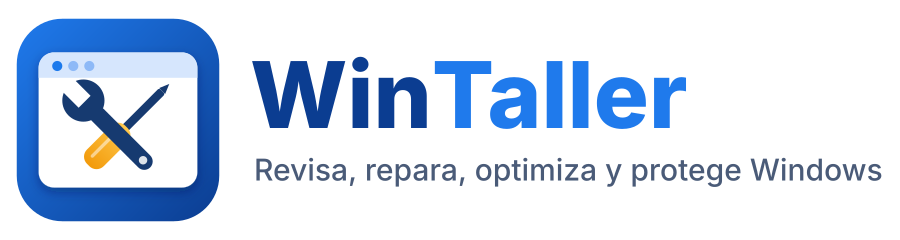

<p align="center">
  <picture>
    <source media="(prefers-color-scheme: dark)" srcset="docs/img/logo-dark.png">
    
  </picture>
</p>

<p align="center">
  <b>Herramienta gratuita para revisar, reparar, optimizar y proteger equipos con Windows 10 y 11.</b><br>
  Sin instalación y sin programas de terceros: usa solo PowerShell y las herramientas que ya trae Windows.
</p>

<p align="center">
  <a href="https://github.com/SylredComputers/WinTaller/releases/latest"></a>
  
  
</p>

<p align="center">Desarrollado por <a href="https://sylredcomputers.com">Sylred Computers</a>, servicio técnico informático en Madrid.</p>

---

## Descarga y uso

1. Ve a **[Releases](https://github.com/SylredComputers/WinTaller/releases/latest)** y descarga `WinTaller-vX.Y.Z.zip`.
2. **Descomprime** el ZIP en una carpeta (por ejemplo, en Documentos). No lo ejecutes desde dentro del ZIP.
3. Haz doble clic en **`Iniciar.bat`** y acepta el aviso de permisos de administrador.

¿Quieres un acceso directo con icono en el Escritorio? Mira [Acceso directo en el Escritorio](docs/MANUAL.md#acceso-directo-en-el-escritorio).

> **Aviso de Windows SmartScreen o del antivirus:** el programa es un script de PowerShell sin firma digital, así que Windows puede mostrar «Windows protegió su PC». Pulsa **Más información → Ejecutar de todas formas**. Si Windows bloquea los archivos por venir de Internet, abre PowerShell en la carpeta y ejecuta:
>
> ```powershell
> Get-ChildItem -Recurse | Unblock-File
> ```
>
> Todo el código es abierto y legible en `WinTaller.ps1`. Puedes comprobar que el ZIP no se ha modificado con el **SHA-256** que aparece en cada versión:
>
> ```powershell
> Get-FileHash .\WinTaller-vX.Y.Z.zip -Algorithm SHA256
> ```

**Requisitos:** Windows 10 u 11 con PowerShell 5.1 (viene de serie). Para instalar programas hace falta **winget** (incluido en Windows 10/11 recientes).

---

## Qué hace

La ventana tiene cuatro pestañas:

### 🖥️ Sistema
- **Servicios:** lista todos los servicios, marca en rojo los que están en marcha y explica **qué pasa si quitas cada uno** (consejo *Quitar / Opcional / No tocar*). Permite detenerlos, deshabilitarlos y reactivarlos. Los servicios críticos de Windows están protegidos.
- **Inicio:** programas que arrancan con Windows, con su **firma digital**. Se pueden deshabilitar y volver a habilitar (mismo método que el Administrador de tareas) o analizar con Microsoft Defender.
- **Drivers:** detecta componentes sin controlador, busca e instala drivers desde **Windows Update**, hace copia de los drivers instalados e instala archivos `.inf`.

### ⚡ Optimización
- **Limpieza y mantenimiento:** temporales, papelera, cachés (Windows Update, navegadores, miniaturas…), volcados de memoria, WinSxS, telemetría, Copilot/Recall, servicios innecesarios, TRIM/desfragmentación y reparación con DISM + SFC. Crea **punto de restauración** y guarda una copia de los ajustes para **revertir** los cambios.
- **Rendimiento:** detecta si es **sobremesa o portátil** y muestra el **estado actual** de cada ajuste (plan de energía, hibernación, efectos visuales, Game DVR…) antes de cambiarlo. Incluye diagnóstico: salud de discos (SMART), pantallazos azules, test de memoria y un **informe HTML del equipo**.

### 📦 Programas
- **Instalar:** catálogo de 65 programas habituales (navegadores, ofimática, multimedia, utilidades, seguridad…) que se instalan en cola con **winget**, al estilo de Ninite.
- **Desinstalar:** lista los programas instalados con su nivel de riesgo y protege los componentes de Windows.

### 🛡️ Protección
- **Seguridad:** revisión del equipo (antivirus, firewall, UAC, SMBv1, BitLocker, arranque seguro, actualizaciones, cuentas, programas de inicio sin firma) y análisis con **Microsoft Defender**: rápido, completo, de una carpeta o USB y sin conexión.
- **Copias:** copia de carpetas con **robocopy** (con verificación) o **imagen completa del sistema** con wbadmin.

Todas las acciones piden confirmación y quedan anotadas en un registro que se puede guardar.

📖 **Manual completo:** [docs/MANUAL.md](docs/MANUAL.md)

---

## Seguridad del propio programa

- No descarga ni ejecuta nada de servidores propios: los programas vienen de **winget** y los drivers de **Windows Update**. El único instalador directo (TinyWall) se descarga por HTTPS desde su web oficial y **solo se instala si su firma digital es válida**.
- Las operaciones con permisos de administrador usan una carpeta protegida (`C:\ProgramData\WinTaller`) a la que solo acceden SYSTEM y Administradores.
- Las limpiezas no siguen enlaces de carpeta (junctions), para no borrar nada fuera de la carpeta que se limpia.

---

## Antes de usarlo

- Crea un **punto de restauración** (primera tarea de *Optimización*) antes de cambiar servicios o ajustes.
- Deshabilitar servicios o desinstalar programas puede afectar a funciones concretas del equipo. La herramienta lo explica en cada caso, pero **revisa siempre lo que vas a cambiar**.
- Este software se ofrece **tal cual, sin garantía** (ver [licencia](LICENSE)). Úsalo bajo tu responsabilidad.

---

## Problemas y sugerencias

- Si la ventana se cierra o no aparece, ejecuta **`Diagnostico.bat`** y revisa el archivo `diagnostico.log` que se crea en la carpeta.
- Para informar de un error o proponer una mejora, abre un **[Issue](https://github.com/SylredComputers/WinTaller/issues)** indicando la versión de Windows y adjuntando el `diagnostico.log` (revisa antes que no contenga datos que no quieras compartir).

---

## Licencia

Distribuido bajo licencia **MIT**. Consulta el archivo [LICENSE](LICENSE).

© Sylred Computers
